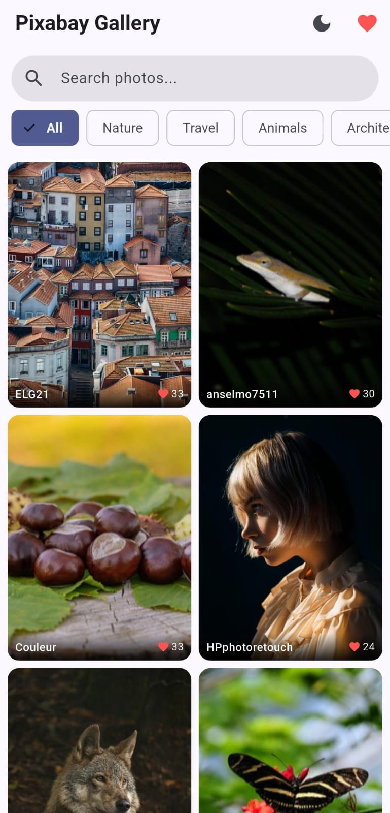
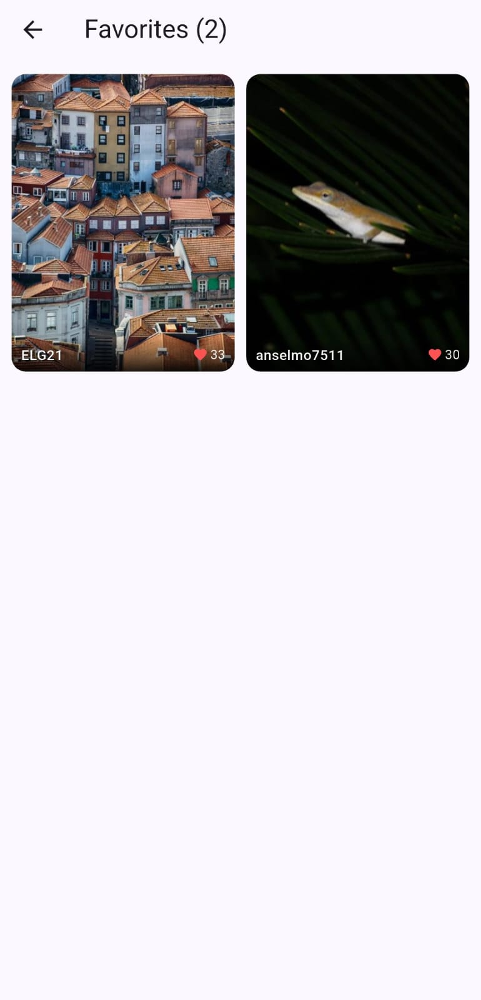
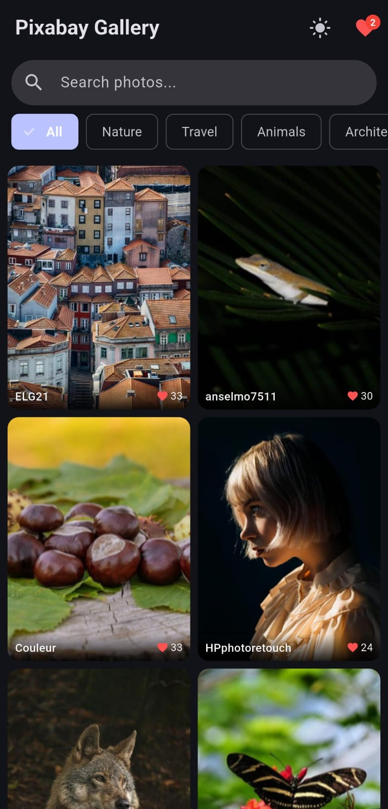

# Infinite Image Gallery App

A responsive Flutter application built for the Gnxtace Technologies Flutter Developer assessment. It consumes the Pixabay API to present an infinite scrolling image gallery with detailed views, image caching, local favorites persistence, and image downloads.

---

## Architecture & State Management

This app uses **Provider** (`ChangeNotifier`) for state management with a clean, feature-focused architecture:
- **Models**: Data classes (`Pic`) handling JSON serialization.
- **Services**: Concrete wrappers for remote API network calls (`ApiService` using Dio) and local storage (`StorageService` using SharedPreferences).
- **Providers**: State containers (`GalleryProvider` for infinite scrolling, pagination, filtering, and search; `FavsProvider` for favorite toggling and caching; `ThemeProvider` for light/dark theme switching).
- **Screens & Widgets**: UI presentation split into modular components (`HomeScreen`, `DetailScreen`, `FavsScreen`, `PicTile`, `ShimmerTile`, `BottomLoader`).

---

## Pixabay API Key Configuration

The Pixabay API key is pre-configured in `lib/services/api.dart`:

```dart
static const apiKey = '58207894-4abbfe3f8e4a304341f26db29';
```

If you wish to change or use your own API key:
1. Obtain a free API key at [pixabay.com/api/docs](https://pixabay.com/api/docs/).
2. Open `lib/services/api.dart`.
3. Replace the `apiKey` string constant with your API key.

---

## Features

### Core Requirements
1. **Gallery Home Screen**: Responsive grid (2 columns in portrait, 3 columns in landscape) with smooth aspect ratio and metadata overlay.
2. **Infinite Scroll & Pagination**: Automatically detects scroll near the bottom and loads the next 20 images seamlessly with a bottom loader.
3. **Loading States**: Centered spinner for initial load and shimmering placeholders for individual tiles.
4. **Error Handling**: Friendly network failure screen with a "Retry" button, plus SnackBar notifications for pagination failures.
5. **Image Detail Screen**: Full-screen view with pinch-to-zoom (`InteractiveViewer`), displaying photographer details, tags, likes, views, and downloads.
6. **Download to Gallery**: Downloads high-resolution images to the device photo gallery with download progress indicator and permissions handling (`permission_handler` and `gal`).
7. **Favorites System**: Toggle favorites on the detail screen with instant local persistence via `shared_preferences`.
8. **Favorites Screen**: Dedicated grid view for saved images with badge indicator on the home screen.
9. **Performance**: Optimized memory and disk caching via `cached_network_image`.

### Bonus Features Implemented
- **Search Bar**: Debounced search query input (500ms debounce) with quick clear button.
- **Category Filter Chips**: Instant category filtering (Nature, Travel, Animals, Architecture, Food, Fashion, Sports, etc.).
- **Pull-to-Refresh**: Native pull down gesture to refresh the gallery.
- **Hero Animations**: Seamless transition from grid tile to full-screen detail view.
- **Dark/Light Theme Toggle**: Quick switcher in the AppBar.
- **Share Image**: Native share sheet support via `share_plus`.
- **Download Progress Bar**: Real-time progress bar on the detail screen during downloads.
- **Automated Tests**: Comprehensive test suite including unit tests for data models, state management, and widget tests.

---

## Getting Started

### Prerequisites
- Flutter SDK (3.10.0 or higher)
- Android Studio / VS Code with Flutter extension
- Physical Android/iOS device or emulator

### Installation & Run

1. Clone or open this repository.
2. Fetch dependencies:
   ```bash
   flutter pub get
   ```
3. Run automated tests:
   ```bash
   flutter test
   ```
4. Run the app:
   ```bash
   flutter run
   ```

### Building Release APK

To build a release APK for Android:
```bash
flutter build apk --release
```
The output APK will be generated at `build/app/outputs/flutter-apk/app-release.apk`.

### Quick Test (Direct APK Install)

A ready-to-install Android APK is available directly in the root repository for testing on physical devices or emulators:
- **Direct APK**: [`test.apk`](test.apk) (arm64-v8a architecture, optimized for modern Android devices).

To install directly using adb:
```bash
adb install -r test.apk
```

---

## Assumptions & Limitations

- **Pixabay API Constraints**: Basic Pixabay tier allows up to 100 requests per minute.
- **Permissions**: Image saving requires storage/photo permissions on mobile devices. On Android 13+, `READ_MEDIA_IMAGES` and scoped storage APIs are used.
- **Offline Mode**: Favorited images load their metadata offline, and previously cached images remain accessible through `cached_network_image`. New network searches require active connectivity.

---

## Screenshots

| Gallery Feed | Saved Favorites | Dark Mode Theme |
|:---:|:---:|:---:|
|  |  |  |
